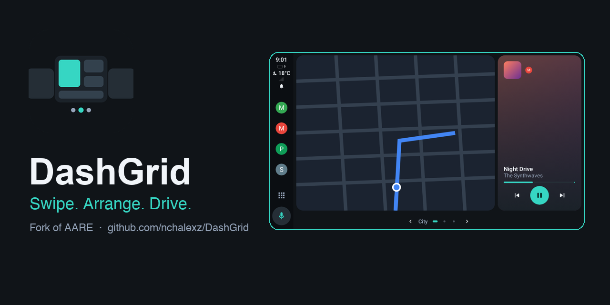
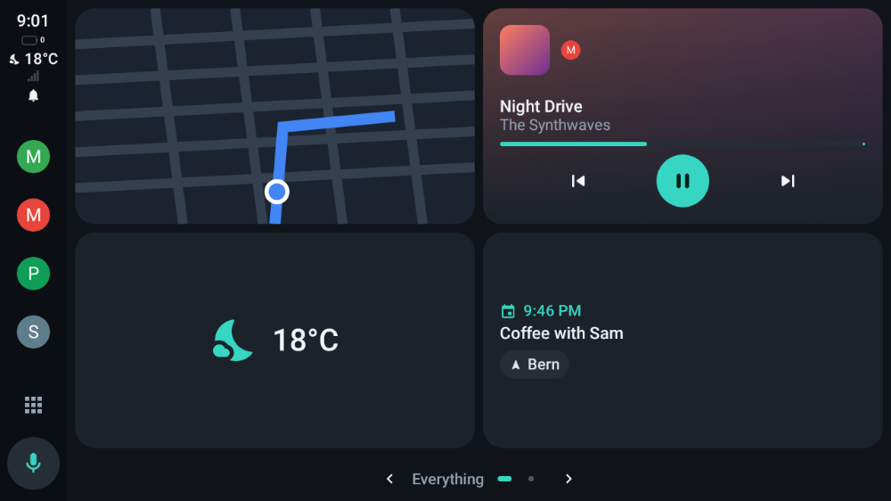
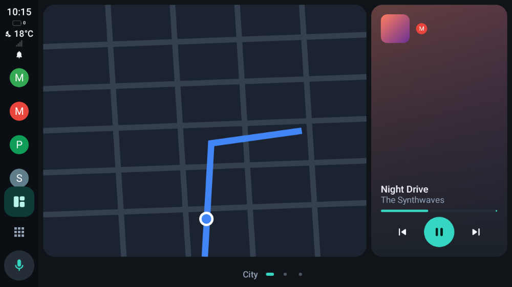

<p align="center">
  
</p>

<p align="center">
  <a href="https://github.com/nchalexz/DashGrid/releases"></a>
  <a href="LICENSE"></a>
  <a href="#install"></a>
  <a href="gradle/libs.versions.toml"></a>
  <a href="DESIGN.md"></a>
  <a href="#security-and-privacy"></a>
</p>

<p align="center">
  <strong>A workspace home screen for Android Auto.</strong><br>
  As many screens as you want, a 10 × 6 grid, live apps in their panes and any Android app widget.
  No root, no GMS, no account.
</p>

<p align="center">
  <a href="#interface">Interface</a> ·
  <a href="#android-auto">Android Auto</a> ·
  <a href="#install">Install</a> ·
  <a href="#what-already-works">Features</a> ·
  <a href="#what-is-tested-what-is-not">Status</a> ·
  <a href="#build">Build</a> ·
  <a href="#architecture">Architecture</a> ·
  <a href="#documentation">Documentation</a>
</p>

> [!WARNING]
> **1.3.0 is stable for the emulator, not verified on a car.**
> It is built, unit-tested and lint-checked, and the VPM cockpit was run with VPM 0.5.0 on an Android
> 15 emulator at 1920 × 720 and 1280 × 480. It has **not been run on a real head unit, a phone in a
> car or EMUI**, and no ELM327 adapter or vehicle was available: the values shown are VPM's demo
> values, not live sensor readings. The details are in
> [What is tested](#what-is-tested-what-is-not).

## What this is

DashGrid is a standalone Android app that gives an Android Auto head unit a set of home screens you
arrange yourself. It runs on the phone and draws into the car's virtual display: workspaces, live
app panes, widgets, a dock and a pager. No Google Mobile Services, no account, no root required.

It began as an independent fork of **AARE 1.6.0**. The Android Auto connection, transport, audio and
app hosting are AARE's work; the workspace home screen, the phone editor, the monochrome dock, the
fixed navigation buttons and the Cockpit are DashGrid's.

DashGrid has its own application ID, signing key, icon and theme. The published APK is standalone: it
defines the car template permission itself, so AARE must be removed before installing it. A
side-by-side build exists for local use, but it is not attached to the release.

Three principles shaped the app:

- **The screen follows the drive.** A workspace is a page with a name, a layout and whatever you
  want on it. One for the city, one for the open road, one for the car — not one dashboard that has
  to fit every trip.
- **One setup, three surfaces.** You arrange everything on the phone; the car screen and the phone
  preview read the same configuration and never create a second one.
- **Nothing hidden.** No account, no ads, no analytics, no Play Services. Workspaces and settings
  stay in the app's own storage.

## Interface

<p align="center">
  
  
  
</p>

<p align="center"><sub>Paparazzi renders on the JVM with DashGrid's own app artwork. They are not a car, a phone or proof of compatibility; the settings preview uses the icons installed on the phone.</sub></p>

| Part | What it does |
|---|---|
| **Workspace** | A 10 × 6 grid of app shortcuts, live app panes, built-in widgets and Android app widgets. |
| **Pager bar** | Workspace name (optional), dots, arrows and a jump menu for long lists. Hidden when there is one workspace. |
| **Dock** | Taskbar, dock or app-grid layout; optional monochrome icons; Home and App Dash can be pinned. |
| **Widget** | A built-in card — map, music, calendar, notifications, weather, smart home or the car — or any Android app widget. |
| **Live pane** | An app's own screen inside its cells: a Car App template, a map, a media screen or a launched phone app. |

## Android Auto

<p align="center">
  
</p>

<p align="center"><sub>Paparazzi render: Home and App Dash pinned at the driver's end of the rail. Not a head-unit screenshot.</sub></p>

DashGrid speaks Android Auto through AARE's stack: USB or wireless, the same certificate handling,
the same app hosting. The head unit sees a normal Android Auto phone; the car screen is a
`Presentation` on the virtual display, while the phone stays usable.

- USB and wireless Android Auto; the certificate flow is unchanged from AARE.
- No root and no Google Play Services. Root or Shizuku are optional for audio capture, phone apps on
  the car screen and a few setup conveniences.
- Car App Library templates, maps, media apps and launched phone apps are hosted in workspaces.
  There is one live map surface per connection.
- The car screen is a viewer: workspaces are arranged on the phone, not on the head unit.
- **Not verified on a real head unit in 1.3.0.** See [What is tested](#what-is-tested-what-is-not).

More: [ARCHITECTURE.md](ARCHITECTURE.md) and [TESTING.md](TESTING.md).

## One setup, three surfaces

| Surface | What it shows | Editable |
|---|---|---|
| **Car screen** | The workspaces, pager and dock, drawn into the head unit's virtual display. | No |
| **Phone editor** | Presets, the 10 × 6 grid, the item inspector and the Android widget picker. | Yes |
| **Phone preview** | The same car screen on the phone, with no car connected. | No |

All three read one `WorkspaceConfig` from `WorkspaceStore`. The editor writes it; `CarRuntime` loads
it and listens for changes. Only the page on screen hosts a live pane or an Android widget, so a
second surface never opens a second app session or a second widget view.

## What already works

**Workspaces**

- Any number of workspaces; name, reorder, duplicate, delete and set a default.
- Cyclic paging by swipe, dots, arrows or the jump menu; the bar name can be hidden.
- A per-workspace **Close apps when hidden** option releases that page's car sessions and surfaces
  and pauses its music. Off, routes and playback stay alive.
- A preinstalled **Car** workspace shows **VAG Performance Monitor**'s cockpit — three gauges, five
  tiles and the category grid — drawn by DashGrid from VPM's read-only snapshot. VPM keeps the only
  ELM327 connection; DashGrid opens none and needs no root ([docs/VPM.md](docs/VPM.md)).
- Settings backup exports and imports the workspaces with the other portable settings.

**Layout and editor**

- Eight presets — 100%, 50/50, 60/40, 70/30, 30/70, three, four, custom — over a 10 × 6 grid.
- Long-press to move an item, resize it and merge cells.
- Move any item, including an Android widget, to another workspace without re-binding it.
- Map and music widgets can be pinned to an app per workspace; a live pane can open full screen when
  its free space is tapped.
- Editing happens on the phone; the car screen stays a viewer.

**Widgets and panes**

- Eight built-in widgets: map, music, calendar, notifications, weather, smart home, the OBD car and
  the VPM cockpit.
- Any standard Android app widget: the provider's own RemoteViews, with Android's permission dialog
  and the provider's configuration screen on the phone. No root and no Shizuku.
- Live app panes, app shortcuts and a per-workspace tap-to-open option for live apps.

**Media**

- The Music widget follows the active media session: artwork, track, progress, seek, play/pause and
  skip, even for players that expose no car library.
- Switching workspaces never stops playback.

**Dock and navigation**

- Taskbar, dock or app-grid layout.
- Monochrome dock icons with four tones — White, Grey, Dark grey and Black — chosen separately for
  the light and the dark theme and applied without a restart.
- Home and App Dash can each be pinned at the driver's end, outside the scrolling row.
- Home returns to the workspace you left; from the app grid, to the main workspace.

**Apps and connection**

- USB and wireless Android Auto through AARE's non-root stack; no Google Play Services.
- Root and Shizuku are optional, never required. The VPM cockpit reads a normal read-only provider
  and needs neither; apps shown in a live pane still do.
- **Hide the Android Auto version of an enabled phone app** removes the duplicate entry from the app
  grid while workspace shortcuts keep working.

**Verification**

- 1,191 JVM tests, Paparazzi renders and `lintVital` on the release build.
- GitHub Actions runs the tests on every push and pull request.

## Install

DashGrid 1.3.0 (**stable**) publishes **one APK: the standalone build**. It cannot be installed while AARE is
installed. The side-by-side variant is buildable locally but is not attached to the release.

| Build | What is inside | Size |
|---|---|---|
| `standalone` | The published APK: workspaces, editor, Android app widgets, dock, Cockpit. | 19 MB |
| `side-by-side` | Local build only; installs next to AARE. | — |

Requirements: Android 6.0 (API 23) or newer, USB or wireless Android Auto, no root, no Google Mobile
Services.

1. If AARE is installed, remove it first — see the note below.
2. Download `DashGrid-standalone-v1.3.0.apk` from
   [Releases](https://github.com/nchalexz/DashGrid/releases).
3. Allow installs from unknown sources if Android asks, then open the file.

Through `adb`:

```sh
adb uninstall net.prototux.aare   # only if AARE is installed
adb install -r DashGrid-standalone-v1.3.0.apk
```

<details>
<summary>SHA-256 and signing certificate</summary>

```text
7a05a80d8a5d0dd2e6ea0b4511d77a6aff5d1b017fb4cd09501481e2248cb456  DashGrid-standalone-v1.3.0.apk
certificate SHA-256: 4c464d2c35c723c2bc4ca30dafa84c3dbdf16473d61ec9961e37dc6e973420a5
```

The APK is signed with `CN=DashGrid`. Check it with
`apksigner verify --print-certs DashGrid-standalone-v1.3.0.apk`.

</details>

> [!NOTE]
> The standalone APK defines `android.car.permission.TEMPLATE_RENDERER` itself, so AARE must be
> uninstalled first; that also removes AARE's settings. DashGrid updates use the same key and install
> over the old build. The published build does not check for updates.

## Quick start

### On the phone

1. Open DashGrid and go to **Settings → Workspaces**.
2. Add a workspace and pick a preset — 70/30 for map and music, four for a 2 × 2, or a custom grid.
3. Add app shortcuts, live apps, built-in widgets or an **Android widget**. Long-press an item to
   move, resize or merge its cells.
4. Set the workspace as default, then tap **Preview car screen** to check it on the phone.
5. Repeat for the other pages; the order here is the order on the car screen.

### In the car

1. Connect the phone over USB or wireless Android Auto and open DashGrid if the head unit asks.
2. Swipe the workspace, tap a dot, use the arrows or press Home. The pages wrap around.
3. Music keeps playing across pages. If a page should release its apps when you leave it, switch on
   **Close apps when hidden** for that workspace.

> [!CAUTION]
> Set up workspaces on the phone, not while driving. Presets, drag, resize and the widget picker need
> attention that the road should not compete with.

## What is tested, what is not

| Check | How | Result |
|---|---|---|
| Standalone build | `./gradlew dashgridStandaloneApk` | **yes** |
| 1,191 JVM tests | `./gradlew :aap:test :app:testDebugUnitTest :headunit:test` | **yes** |
| Release lint | `lintVital` | **yes** |
| Car-screen renders | Paparazzi on the JVM | **yes** |
| CI | GitHub Actions on push and pull request | **yes** |
| Phone preview and the Car workspace | Android 15 emulator, 1920 × 720 and 1280 × 480 | **yes** |
| VPM cockpit with VPM's demo values | emulator, VPM 0.5.0 provider | **yes** |
| VPM cockpit with VPM 0.5.0 bridge | emulator, `content call` + cockpit | **yes** |
| VPM 0.4.1 / no VPM cards | emulator, install 0.4.1, uninstall VPM | **yes** |
| Live values from an ELM327 or a car | real adapter and vehicle | **no** |
| Android widget host on a car screen | real `Presentation` or head unit | **no** |
| Real head unit, USB or wireless | — | **no** |
| EMUI 14+ | — | **no** |
| Third-party icons and dock tones | real icons on a real screen | **no** |

Unit tests, Paparazzi renders and CI are **not** compatibility proof. The cockpit and the Car
workspace were run on an emulator with VPM 0.5.0's read-only provider; no real car, head unit or
phone was available, and the provider had no ELM327 adapter, so the values are VPM's demo values.
The exact checklist and the open points are in [TESTING.md](TESTING.md).

## Build

Needs JDK 17–21, Android SDK platform 37 and build-tools 36.0.0:

```sh
echo "sdk.dir=/path/to/android-sdk" > local.properties

# debug APK
./gradlew assembleDebug

# the published standalone APK
./gradlew dashgridStandaloneApk

# side-by-side APK, for installing next to AARE
./gradlew dashgridApk
```

Outputs:

```text
app/build/outputs/dashgrid/DashGrid-standalone-v1.3.0.apk
app/build/outputs/dashgrid/DashGrid-v1.3.0.apk
```

Tests:

```sh
./gradlew :aap:test :app:testDebugUnitTest :headunit:test
```

Signing reads `keystore.properties`, which is not committed, or the `DASHGRID_KEYSTORE*` environment
variables. Without it, the release APK is unsigned. Start from
[`keystore.properties.example`](keystore.properties.example) and keep the keystore backed up:

```properties
storeFile=keystore/dashgrid-release.jks
storePassword=...
keyAlias=dashgrid
keyPassword=...
```

## Architecture

```text
MainActivity (phone)                        CarRuntime (car session)
  WorkspaceSettings                          CarShell / DockShell
  AndroidWidgetPicker                               │
         │                                          ▼
         └──────────► WorkspaceStore ───────► WorkspaceHome
                      (JSON in Settings)     (Presentation)
                                                    │
                                              WorkspaceItem
                                              ├── APP / PANE      → Car App sessions, surfaces
                                              ├── WIDGET          → AARE dashboard card
                                              └── ANDROID_WIDGET  → AppWidgetHostView
```

`WorkspaceStore` is the only writer: it loads, saves and migrates the workspace JSON through
`Settings`. `CarRuntime` loads the config and listens for changes; `WorkspaceHome` draws the pages in
the car screen's `Presentation`. Only the visible page hosts a live pane or an Android widget, which
keeps one map surface and one widget view alive at a time. AARE's protocol, transport and audio
layers are deliberately unchanged.

More: [ARCHITECTURE.md](ARCHITECTURE.md).

## Workspace catalog

| Preset | Slots | What it is |
|---|---:|---|
| 100% | 1 | One item across the whole workspace. |
| 50/50 | 2 | Two equal items. |
| 60/40 | 2 | A larger first item and a narrower second one. |
| 70/30 | 2 | The hero layout: map on the left, music on the right. |
| 30/70 | 2 | The same split with the emphasis on the second item. |
| Three | 3 | Three columns. |
| Four | 4 | A 2 × 2 grid. |
| Custom | 60 | Free 10 × 6 grid: move, resize and merge. |

Two-item presets split side by side or top and bottom. Deleting an item reflows the preset; switching
a preset refuses if the remaining items do not fit. Any item kind — shortcut, live pane, built-in
widget or Android widget — can occupy any slot.

## Limitations

- **No hardware verification.** 1.3.0 has not been run on a head unit, a phone in a car or EMUI; the
  widget host, dock tones, third-party icons and the VPM cockpit are not confirmed on a real screen.
  The cockpit was checked on an emulator only, with VPM 0.5.0's demo values.
- **AARE must go first.** The standalone APK cannot coexist with AARE, and the side-by-side build is
  not published.
- **One live map surface per connection.** Inactive workspaces show a placeholder.
- **One live Android widget view per bound id.** The phone preview shows a placeholder while a real
  car session is connected.
- **Widget `PendingIntent`s.** A widget button whose action is an activity `PendingIntent` may open
  on the phone or be refused; broadcast and service actions are unaffected.
- **Third-party dock icons.** Tones read differently from app to app because they follow each icon's
  own artwork.
- **The VPM cockpit needs VPM 0.5.0 or newer.** This is the only part of DashGrid that needs VPM:
  workspaces, the OBD widget, live panes and the dock work without it. 0.4.1 exports no telemetry
  snapshot, so the preinstalled Car workspace explains that and offers **Update VPM** / **Open on
  the phone** instead of gauges. Android grants the normal `READ_TELEMETRY` permission when DashGrid is installed after
  VPM 0.5.0; a DashGrid installed earlier must be updated or reinstalled once. The contract is in
  [docs/VPM_BRIDGE_PROMPT.md](docs/VPM_BRIDGE_PROMPT.md).
- **No in-app update check.** New releases are installed by hand.
- **Head-unit quirks remain AARE's.** `vehicles.json` still handles cars that need a different
  protocol; DashGrid does not change that layer.

## Security and privacy

DashGrid is a local app. It has no account, no ads, no analytics and no telemetry. Workspaces and
settings live in the app's own `SharedPreferences`; **Settings backup** is user-initiated and leaves
out trusted head units, certificates and the switches that open the app to the network or lift a
safety check.

Network access is used for the Android Auto connection, the weather card (Open-Meteo, with an
approximate position), the optional certificate download, and the smart-home actions or MQTT/HTTP
endpoints you configure. DashGrid has no server of its own. Root, Shizuku and a privileged install
are optional; the normal connection and the workspaces work without them.

The published APK is signed with DashGrid's own key; the SHA-256 and the certificate fingerprint are
in [Install](#install). AARE's TLS and certificate handling are unchanged.

## Documentation

| File | About |
|---|---|
| [`ARCHITECTURE.md`](ARCHITECTURE.md) | Workspaces, panes, paging, widgets, dock and how they fit into AARE |
| [`docs/ANDROID_WIDGETS.md`](docs/ANDROID_WIDGETS.md) | Android app widgets: architecture, adding one, limits, test status |
| [`docs/VPM.md`](docs/VPM.md) | The preinstalled Car workspace, the native VPM cockpit, its read-only contract and its states |
| [`docs/VPM_BRIDGE_PROMPT.md`](docs/VPM_BRIDGE_PROMPT.md) | The read-only provider VPM implements (contract v1, task for the VPM repository) |
| [`docs/VPM_COMPAT_PROMPT.md`](docs/VPM_COMPAT_PROMPT.md) | The cross-repository session: VPM bridge, both test suites, the compatibility matrix and both releases |
| [`docs/vehicles.md`](docs/vehicles.md) | Per-car overrides for head units that need a different protocol |
| [`docs/home-actions.md`](docs/home-actions.md) | Home shortcuts and the actions DashGrid exports |
| [`DESIGN.md`](DESIGN.md) | Palette, icon, typography and car-UI rules |
| [`TESTING.md`](TESTING.md) | Automated tests, build checks and the open device checklist |
| [`RELEASE_NOTES.md`](RELEASE_NOTES.md) | What shipped in 1.3.0, with install and limits |
| [`CHANGELOG.md`](CHANGELOG.md) | Every change relative to AARE 1.6.0 |
| [`UPSTREAM.md`](UPSTREAM.md) | Base commit, merge process, identifiers that must not change |
| [`docs/EXTERNAL_THEMES.md`](docs/EXTERNAL_THEMES.md) | Theme-file proposal (not implemented) |

## Contributing

The project is open to help, but data beats enthusiasm:

- **Test on real hardware.** The checklist is in [TESTING.md](TESTING.md). Report the phone, the head
  unit, the connection type and what worked — that is the biggest gap right now.
- **Report bugs.** Include the phone model, Android version, connection type, steps to reproduce
  and, if possible, the connection log or `adb logcat`.
- **Send code.** Read [ARCHITECTURE.md](ARCHITECTURE.md), [DESIGN.md](DESIGN.md) and
  [UPSTREAM.md](UPSTREAM.md) first. AARE's protocol, transport and audio layers are deliberately
  unchanged; keep them that way.
- **Translate.** English and Russian are maintained for DashGrid's own strings. Other AARE locales
  keep working and fall back to English for the new screens.

## License

[GPL-3.0-or-later](LICENSE). DashGrid is a fork of [AARE](https://github.com/prototux/AARE) 1.6.0 by prototux
and the AARE contributors; their copyright and licence notices are kept. The screenshot renders use
[Paparazzi](https://github.com/cashapp/paparazzi); the Cockpit uses
[Titillium Web](https://fonts.google.com/specimen/Titillium+Web) (SIL Open Font License). Android
Auto is a Google trademark; DashGrid is not affiliated with Google.

<p align="center"><sub>Built for the drive, not for the setup screen.</sub></p>
