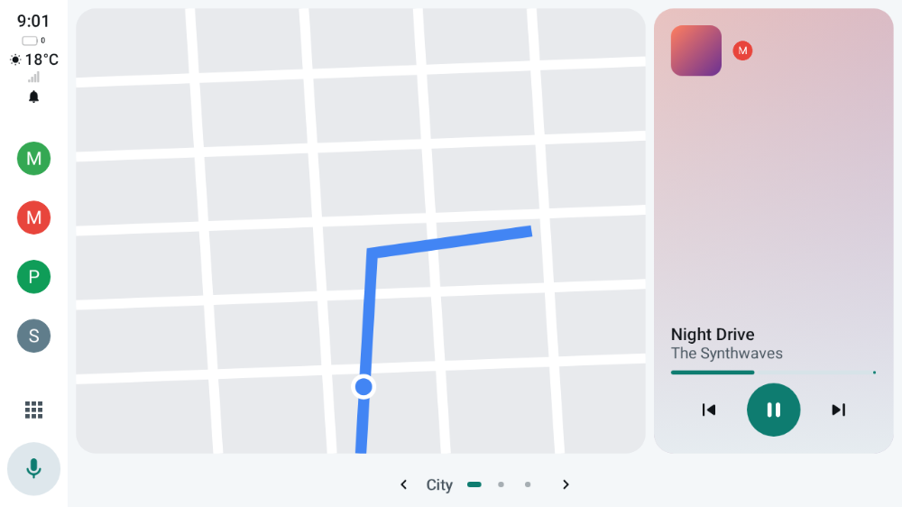

# DashGrid

**Swipe. Arrange. Drive.**

**Language:** **English** · [Русский](README.ru.md)

DashGrid is an independent, installable fork of [AARE](https://github.com/prototux/AARE) — the
open-source replacement for the phone side of Android Auto — that turns the car's home screen into
a set of switchable workspaces with a configurable grid of apps and widgets.

> **This repository is a fork of AARE.** The projection protocol, transport, audio, microphone,
> app hosting, the AndroidX Car App Library host, CarPlay-like and classic layouts, media and
> messaging screens, OBD support and almost all user-facing features come from AARE (GPL-3.0,
> © the AARE contributors). DashGrid adds the workspace system, its editor and its branding. See
> [UPSTREAM.md](UPSTREAM.md) for the exact base, the licence and how updates are merged.

## Кратко по-русски

**DashGrid** — независимый форк AARE: несколько переключаемых рабочих столов на экране автомобиля,
настраиваемые сетки приложений и виджетов, редактор на телефоне. Свой application ID, иконка, тема и
ключ подписи, поэтому AARE и DashGrid можно установить рядом.

- Рабочие столы переключаются по кругу свайпом, стрелками или точками.
- Раскладки: 100 %, 50/50, 70/30, 30/70, три виджета, четыре виджета и своя сетка 10 × 6 с
  перетаскиванием, изменением размера и объединением ячеек.
- Виджеты: карта, музыка, календарь, уведомления, погода, умный дом, OBD. Карту и музыку можно
  привязать к конкретному приложению.
- Переключение не перезапускает приложения: маршрут, музыка и сессии сохраняются.
- Установка: [DashGrid-v1.0.0.apk](https://github.com/nchalexz/DashGrid/releases/download/dashgrid-v1.0.0/DashGrid-v1.0.0.apk)
  (Android 6+, без обязательного root и GMS).
- На реальном автомобиле и на Huawei/EMUI пока не проверялось — только сборка, 867 тестов и
  JVM-макеты UI. Подробнее — [TESTING.md](TESTING.md).

[Полное описание на русском →](README.ru.md)

<p align="center">
  
</p>

<p align="center">
  
  
</p>
<p align="center">
  
  
</p>

*Mockups rendered from the real Compose UI by Paparazzi (no emulator): 70/30 with the pager bar,
four widgets, three widgets, and day colours. A real head unit can differ in fonts and the map
provider's drawing.*

## What DashGrid adds

- **Workspaces** — any number of independent home screens. Each has its own name, order,
  layout, app shortcuts and widgets.
- **Cyclic switching** — swipe the pager bar (or anywhere, if you allow it), use the arrows, or
  tap a dot. Past the last workspace comes the first one; back from the first goes to the last.
- **Grid layouts** — 100 %, 50/50, 70/30, 30/70, three widgets and four widgets, plus a custom
  10 × 6 grid where items can be dragged, resized and merged into larger cells.
- **Widgets** — map, music, next calendar event, latest notification, weather, smart-home actions
  and live OBD data, placed per workspace. A map or music widget can follow a specific app.
- **App shortcuts** — Car App Library apps, media apps, and DashGrid's built-in screens (phone,
  notifications, browser, car data, Home, OBD, phone screen).
- **Phone editor** — *Settings → Workspaces*: create, rename, duplicate, reorder and delete
  workspaces; pick a layout; add, move, resize and remove items; choose the default workspace;
  preview the result, or open the car screen on the phone.
- **Branding** — its own application ID (`io.dashgrid.app`), icon, theme and signing key, so AARE
  and DashGrid can be installed side by side without sharing data or settings.

Everything AARE does still works: USB and wireless projection, Google Maps/Waze guidance via
notifications, music, messages, calls, the assistant, day/night themes, the dashboard widgets,
split screen, the phone-screen mirror, OBD and the desktop head unit.

## Requirements

- A phone with Android 6 or newer (Android 8+ for all features), the same as AARE.
- A car with Android Auto over USB or wireless, or the desktop head unit / car-screen preview
  to try it without a car.
- **No root and no Google Play Services are required.** Root or Shizuku only unlock the optional
  AARE features that always needed them (car audio channels, ordinary phone apps on the car
  screen, the phone's location).

## Install

Download [DashGrid-v1.0.0.apk](https://github.com/nchalexz/DashGrid/releases/download/dashgrid-v1.0.0/DashGrid-v1.0.0.apk)
from the [release](https://github.com/nchalexz/DashGrid/releases/tag/dashgrid-v1.0.0) (or build it,
below) and open it on the phone:

```sh
adb install -r DashGrid-v1.0.0.apk
```

DashGrid is signed with its own key (`SHA-256` of the certificate is printed by
`apksigner verify --print-certs`). AARE and DashGrid are different packages, so both can be
installed; Android may ask which one should answer a head unit when both are connected.

Because it is a fork, apps built with the AndroidX Car App Library may trust AARE's signing
certificate but not DashGrid's. Those apps need DashGrid added to their host allow-list (the same
limitation every fork has). Apps that trust hosts holding
`android.car.permission.TEMPLATE_RENDERER` work unchanged; the permission is declared by DashGrid
as AARE does.

## Build

Requirements: JDK 17–21, Android SDK platform 37 and build-tools 36.0.0, and an SDK path in
`local.properties`:

```properties
sdk.dir=/path/to/android-sdk
```

```sh
# Debug APK
./gradlew assembleDebug

# Signed release APK, renamed to DashGrid-v<version>.apk
./gradlew dashgridApk
# -> app/build/outputs/dashgrid/DashGrid-v1.0.0.apk
```

Signing reads `keystore.properties` (ignored by git; see
[keystore.properties.example](keystore.properties.example) and [keystore/README.md](keystore/README.md)):

```properties
storeFile=keystore/dashgrid-release.jks
storePassword=…
keyAlias=dashgrid
keyPassword=…
```

Without it, `assembleRelease` produces an unsigned APK. **Back up the keystore**: an update must be
signed with the same key or Android will refuse to install it over an existing DashGrid.

The APK name and `applicationId` are set in [app/build.gradle.kts](app/build.gradle.kts)
(`versionCode`/`versionName` are raised there too; `-PversionName=…` overrides them).

## Tests

```sh
./gradlew testDebugUnitTest
```

Workspace-model tests cover serialization, migration from the old single dashboard, cyclic
indexing, layouts, the cell grid and editing operations. The results and the scenarios that were
**not** run (no car, no head unit here) are listed honestly in [TESTING.md](TESTING.md).

## Using the car screen

- The rail, themes, day/night colours and all AARE screens are unchanged.
- With more than one workspace, a compact pager bar sits along the bottom: name, dots, arrows.
  A horizontal drag on the bar switches workspaces; so does a drag on empty space between items.
  Turn on *Swipe anywhere* to make the whole page the pager's gesture area — at the cost of the
  map's own horizontal gestures.
- The app grid (rail's menu button) still lists every app; workspaces are shortcuts, not a
  replacement for the launcher.
- Open an item to launch its app full screen. Going home returns to the workspace you left.

## Known limitations

- **Workspaces are the home screen of the taskbar and dock layouts.** The classic (2019 Android
  Auto) layout keeps its app-grid home, exactly as AARE.
- **Only the current workspace is live.** A map widget gets the app's surface only while its page
  is on screen; the page beside it shows a placeholder. This is deliberate: one
  `CarAppConnection` has one surface, and drawing two maps would make the navigation app fight
  itself. Route, playback and app state survive the switch.
- **Two navigation apps** can be connected (one as the active navigation app, the other opened
  beside it in split screen). Only the active one owns the dashboard map, the cluster and
  "navigate to"; Android may pause a background app's surface. See [ARCHITECTURE.md](ARCHITECTURE.md).
- The **CarControlProvider** authority is `io.dashgrid.app.car` and the assistant link scheme is
  `dashgrid://`, so AARE and DashGrid don't conflict. Assistants hard-coded for AARE's authority
  or `aare://` links won't call DashGrid until they add it.
- **Portrait head units** get the same logical 10 × 6 grid turned 90°; the editor previews only the
  landscape orientation.
- **Not tested on a physical car.** See TESTING.md.

## Project layout

| Path | What it is |
|---|---|
| `app/src/main/java/net/prototux/aare/` | AARE's code, kept in its original packages (upstreamable) |
| `app/src/main/java/net/prototux/aare/workspace/` | Workspace model, JSON store, migration, app catalog |
| `app/src/main/java/net/prototux/aare/ui/car/WorkspaceHome.kt` | Car-screen pager, grid, widgets, pager bar |
| `app/src/main/java/net/prototux/aare/ui/WorkspaceSettings.kt` | Phone editor |
| `app/src/test/java/net/prototux/aare/workspace/` | Model, migration and behaviour tests |
| `docs/` | AARE's upstream documentation (protocol, certificates, decisions) |

Package names inside the app intentionally stay `net.prototux.aare`: only the installable identity
(application ID, label, icon, signing key and the public identifiers listed in UPSTREAM.md) changed.
That keeps merges from AARE practical.

## Documentation

- [ARCHITECTURE.md](ARCHITECTURE.md) — how workspaces fit into AARE, lifecycle and surfaces
- [DESIGN.md](DESIGN.md) — colours, icon, type and car-UI rules
- [CHANGELOG.md](CHANGELOG.md) — what changed relative to AARE 1.6.0
- [TESTING.md](TESTING.md) — tests run and the manual checklist
- [UPSTREAM.md](UPSTREAM.md) — upstream base, how to merge updates, what must not change
- [docs/assistant-links.md](docs/assistant-links.md) — `dashgrid://` assistant links
- [AARE's README](https://github.com/prototux/AARE#readme) — everything inherited
- [README.ru.md](README.ru.md) — полное описание на русском

## Licence and attribution

DashGrid is distributed under the **GNU General Public License v3.0 or later**, like AARE. See
[LICENSE](LICENSE). AARE is © the AARE contributors; DashGrid's additions are © the DashGrid
contributors. The name "Android Auto" is Google's; DashGrid is not affiliated with Google.
