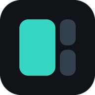
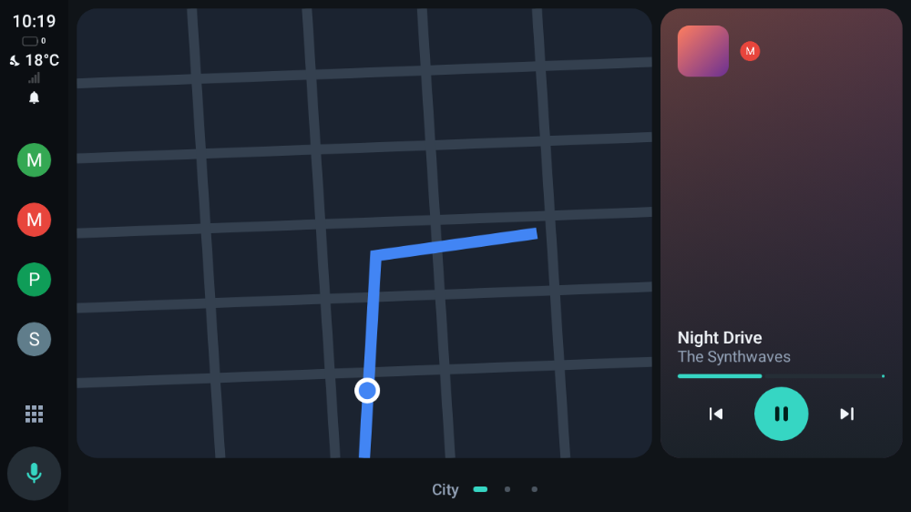
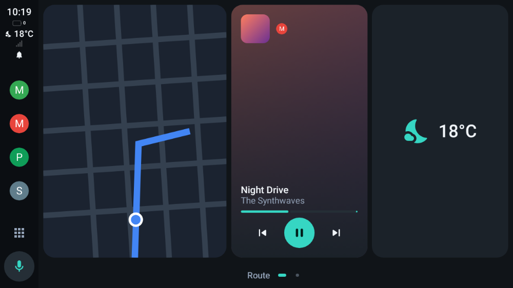
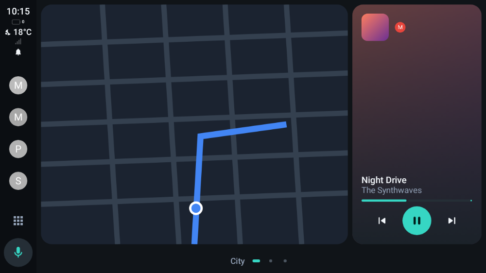

<p align="center">
  
</p>

<h1 align="center">DashGrid</h1>

<p align="center"><strong>Swipe. Arrange. Drive.</strong></p>

<p align="center">
  Your car screen, arranged the way you drive.<br>
  One page for the city, one for the open road, one for the car itself — and you decide what lives on each.
</p>

<p align="center">
  
  
  
  
</p>

<p align="center">
  <a href="https://github.com/nchalexz/DashGrid/releases/download/dashgrid-v1.1.0/DashGrid-standalone-v1.1.0.apk">
    
  </a>
</p>

<p align="center">
  
</p>

> **AARE underneath.** DashGrid is an independent fork of [AARE](https://github.com/prototux/AARE).
> The Android Auto connection, the sound, the app hosting and the built-in screens are AARE's work.
> The home screen, the editor and the look are DashGrid's. If you've used AARE before, everything
> under the surface will feel familiar.

## A home screen that fits the drive

Most car screens give you one layout and hope it works for every trip. DashGrid treats the screen
like a small stack of pages instead. A workspace is just that: a page with a name, a layout and
whatever you want on it. Swipe sideways, tap a dot, or press Home. The last page wraps around to
the first, so the gesture never dead-ends.

The point is not to fill the screen with controls. It is to stop hunting for the same app every
time you get in.

**At a glance:** any number of workspaces · a 10 × 6 grid · seven widget types · live app panes ·
three layouts (taskbar, dock, classic).

## What it feels like

**Arrange once, then leave it alone.** Put a map and music side by side for the city, a weather
card and the next calendar event for a longer drive, or one big app for the car. Presets cover
100 %, 50/50, 60/40, 70/30, 30/70, three widgets, four widgets and a free 10 × 6 grid.

**Resize by dragging.** Long-press an item on the phone, move it, change its width and height, and
let it merge cells. Map and music widgets can be pinned to a particular app per workspace, so each
page keeps its own player instead of following whatever opened last.

**Let an app draw itself.** A live pane is an app's own screen inside its cells — a Car App
template, a map, a media screen, a launched phone app — with the same rounded corners as the
widgets around it. A per-workspace option can open a live app full screen when you tap its free
space, as tapping a widget card does; the app's own controls keep working. Shortcuts are still
there when you just want an icon that opens full screen.

**Edit on the phone. Drive on the car.** The editor needs a keyboard, precision touch and room for
a layout preview. The car screen stays a viewer, with no setup panels in the way.

**Keep the music going.** Switching pages never stops playback. The Music widget follows the active
media session — artwork, track, progress, seek, play/pause and skip — even for players that don't
expose a car library. No root and no Google Play Services.

**Let it go when you leave.** Each workspace can close its apps when you switch away: this releases
the car-side sessions and surfaces of that page and pauses its music. Leave the option off and
routes, playback and app state stay alive, as before.

**Host the widgets you already use.** A standard Android App Widget can sit in a workspace's
cells: a clock, a weather card, a fuel log, an OBD dashboard from another app. It is the provider's
own live RemoteViews — it updates, scrolls and takes taps like on a launcher — not a screenshot.
Any installed provider appears in the picker; the first one from an app asks for Android's own
permission on the phone, and the provider's configuration screen opens there too. No Shizuku, no
root. See [docs/ANDROID_WIDGETS.md](docs/ANDROID_WIDGETS.md).

**Let the dock match the car.** Turn the dock's icons monochrome and pick a tone for the light and
the dark theme — white, grey, dark grey or black. The icon's shape, logo and detail stay; only its
brightness range changes, and the setting applies to the dock alone (the app grid keeps its
colours). Home and App Dash can each be pinned to a fixed place in the dock, on every screen,
without waiting for the recent apps to make room.

**Keep your own identity.** Different application ID, signing key, icon and theme from AARE. The
published build stands on its own.

## Screens

| 70 / 30 with pager | Four widgets |
|:--:|:--:|
|  |  |
| **Three columns** | **Day colours** |
|  |  |
| **Monochrome dock (dark)** | **Fixed Home and App Dash** |
|  |  |
| **Four dock tones, dark theme** | **Four dock tones, light theme** |
|  |  |

The tone sheets are drawn from DashGrid's own app artwork by Paparazzi on the JVM; the settings
preview uses the icons installed on the phone. No emulator or car was used for them.

## Android widgets

Add one in **Settings → Workspaces**, edit a workspace, tap **Android widget**, choose a provider.
Android asks for permission the first time (on the phone), the provider may open its setup screen,
and the widget then draws itself in the cells. It keeps its own design: no tint, no scaling, no
dock filter. Full instructions and the limits: [docs/ANDROID_WIDGETS.md](docs/ANDROID_WIDGETS.md).

## Install

This release ships **one APK: the standalone build**. It carries its own legacy host permission,
which means it cannot be installed while AARE is installed. If AARE is still on the phone, remove
it first; that also removes AARE's settings.

```sh
adb uninstall net.prototux.aare
adb install -r DashGrid-standalone-v1.1.0.apk
```

- Download: [DashGrid-standalone-v1.1.0.apk](https://github.com/nchalexz/DashGrid/releases/download/dashgrid-v1.1.0/DashGrid-standalone-v1.1.0.apk)
- Package: `io.dashgrid.app`, version 1.1.0 (10100)
- SHA-256: `f8ac4d91fe220fb0c2f01ac9cb810f5264086d2995e49c396636025c2310778a`
- Signed with DashGrid's own key (`CN=DashGrid`); future updates must use the same key.

Prefer to keep AARE installed? The side-by-side variant is still buildable locally with
`./gradlew dashgridApk`; it is not attached to this release.

## Build

<details>
<summary>Requirements and commands</summary>

JDK 17–21, Android SDK platform 37, build-tools 36.0.0, and an SDK path in `local.properties`:

```properties
sdk.dir=/path/to/android-sdk
```

```sh
# Debug APK
./gradlew assembleDebug

# Published standalone release APK
./gradlew dashgridStandaloneApk
# -> app/build/outputs/dashgrid/DashGrid-standalone-v1.1.0.apk

# Side-by-side variant for installing next to AARE (local use)
./gradlew dashgridApk
# -> app/build/outputs/dashgrid/DashGrid-v1.1.0.apk
```

Signing reads `keystore.properties`, which is not committed. See
[keystore.properties.example](keystore.properties.example) and [keystore/README.md](keystore/README.md).
Back up the keystore and its passwords: without them a future build cannot update an installed
DashGrid.

</details>

## Good to know

- **No root, no Google Play Services.** AARE's non-root connection and audio paths are enough.
- **The published APK is standalone.** It cannot sit beside AARE; the side-by-side build is a
  local variant.
- **Music apps:** AARE's full car library appears for apps that expose one. Apps that only publish
  a media session still get artwork, metadata, seek and transport in the Music widget.
- **Home from the app grid:** an app opened there returns to the **main** workspace when you press
  Home, since the grid belongs to no workspace. Apps opened from a workspace return to it.
- **Assistant button:** the bar's microphone can be hidden in *Settings → Voice assistant*; the
  steering wheel's voice key and the assistant's own stop button keep working.
- **One entry per app:** when a phone app enabled on the car screen also has an Android Auto
  version, *Settings → Apps* → **Hide the Android Auto version of an enabled phone app** leaves only
  the phone version in the app grid. Off by default; workspace shortcuts keep working.
- **Head units:** USB and wireless Android Auto, plus the certificate flow, are unchanged from AARE.

## Documentation

| Document | Contents |
|:--|:--|
| [ARCHITECTURE.md](ARCHITECTURE.md) | How workspaces, panes, paging, widgets and the dock fit into AARE |
| [docs/ANDROID_WIDGETS.md](docs/ANDROID_WIDGETS.md) | Android App Widgets: architecture, adding one, limits, test status |
| [docs/EXTERNAL_THEMES.md](docs/EXTERNAL_THEMES.md) | Proposal for theme files (not implemented) |
| [DESIGN.md](DESIGN.md) | Palette, icon, typography and car-UI rules |
| [TESTING.md](TESTING.md) | Automated tests and build checks |
| [CHANGELOG.md](CHANGELOG.md) | Changes relative to AARE 1.6.0 |
| [UPSTREAM.md](UPSTREAM.md) | Base commit, merge process, identifiers that must not change |

## По-русски

**DashGrid** — независимый форк AARE с переключаемыми рабочими столами. Одна страница для города,
другая для трассы, третья для самой машины — вы решаете, что на каждой.

- Страницы листаются свайпом или точками; название на панели можно отключить.
- Сетка 10 × 6: перетаскивание, изменение размера, объединение ячеек.
- Живые панели приложений и виджеты; карту и музыку можно закрепить за приложением.
- Музыка не прерывается при переключении страниц; для каждого стола можно включить закрытие приложений при скрытии.
- Установка: [DashGrid-standalone-v1.1.0.apk](https://github.com/nchalexz/DashGrid/releases/download/dashgrid-v1.1.0/DashGrid-standalone-v1.1.0.apk).
  AARE нужно удалить: standalone-сборка не ставится рядом с ним.

## Licence

GPL-3.0-or-later. AARE © the AARE contributors; DashGrid additions © the DashGrid contributors.
Android Auto is a Google trademark; DashGrid is not affiliated with Google.
