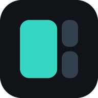
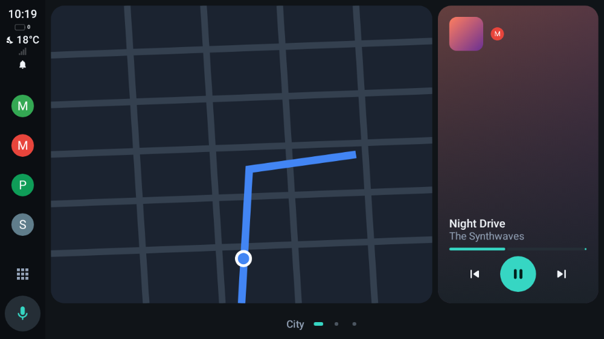
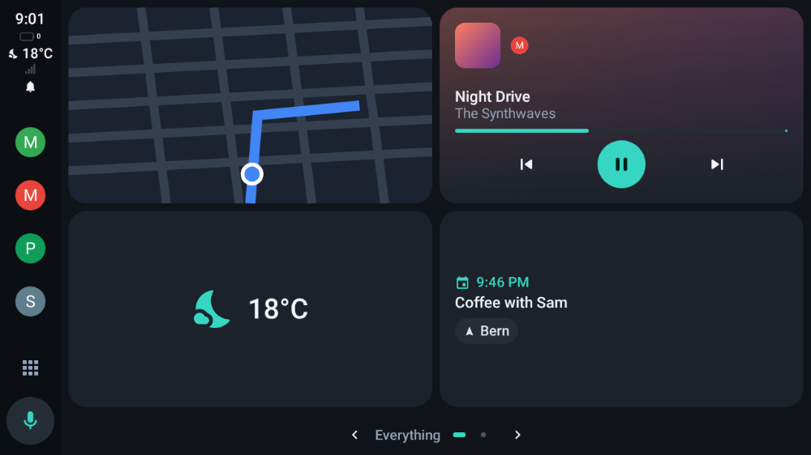
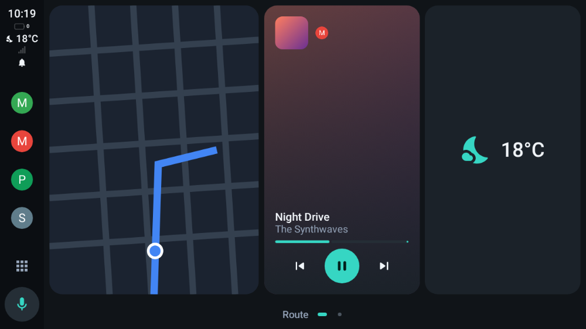
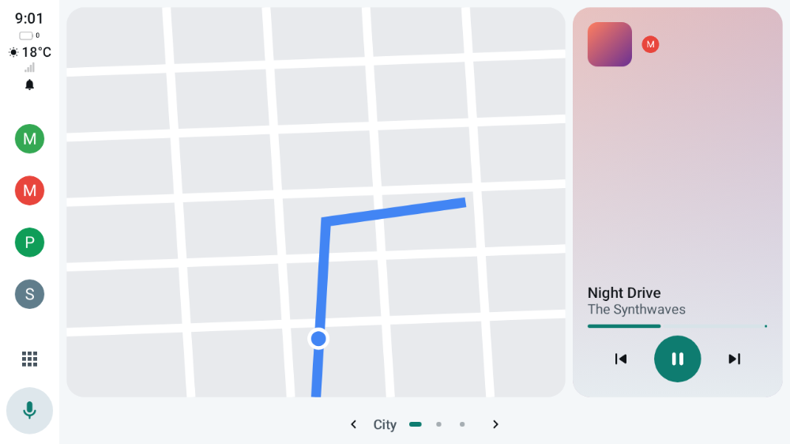

# DashGrid

**Swipe. Arrange. Drive.**

**Язык:** [English](README.md) · **Русский** · [Кратко на главной](README.md#кратко-по-русски)

DashGrid — независимый устанавливаемый форк [AARE](https://github.com/prototux/AARE), открытой
реализации телефонной стороны Android Auto. Форк превращает домашний экран автомобиля в набор
переключаемых рабочих столов с настраиваемой сеткой приложений и виджетов.

> **Это форк AARE.** Протокол проекции, транспорт, аудио, микрофон, хостинг приложений и
> AndroidX Car App Library, раскладки в стиле CarPlay и классического Android Auto, экраны музыки и
> сообщений, поддержка OBD и почти вся пользовательская функциональность взяты из AARE (GPL-3.0,
> © участники AARE). DashGrid добавляет систему рабочих столов, её редактор и собственный брендинг.
> Базовая версия и порядок обновлений описаны в [UPSTREAM.md](UPSTREAM.md).

<p align="center">
  
</p>

<p align="center">
  
  
</p>
<p align="center">
  
  
</p>

*Макеты отрисованы из настоящего Compose-UI через Paparazzi, без эмулятора. Реальная магнитола
может отличаться шрифтами и отрисовкой карты.*

## Что добавляет DashGrid

- **Рабочие столы** — любое количество независимых домашних экранов. У каждого своё имя, порядок,
  раскладка, ярлыки приложений и виджеты.
- **Циклическое переключение** — свайп по панели (или по всей странице, если разрешить) или
  нажатие на точки. После последнего рабочего стола идёт первый, назад с первого — последний.
  Название на панели можно отключить.
- **Раскладки** — 100 %, 50/50, 70/30, 30/70, три виджета, четыре виджета, а также своя сетка
  10 × 6, где элементы можно перетаскивать, растягивать и объединять в крупные ячейки.
- **Виджеты** — карта, музыка, ближайшее событие календаря, последнее уведомление, погода,
  действия умного дома и живые данные OBD. Карту и музыку можно привязать к конкретному приложению.
- **Живые панели приложений** — экран приложения отрисовывается прямо в ячейках: шаблоны Car App,
  карта, медиаэкран, запущенное приложение телефона; скругление как у виджетов. Ярлыки остаются
  отдельным, более лёгким типом.
- **Плееры без MediaBrowser — в виджете «Музыка»** — Яндекс Музыка и другие приложения, чей
  MediaBrowser закрыт для сторонних хостов, показываются через системную медиасессию: обложка,
  трек, прогресс и перемотка, play/pause, предыдущий/следующий. Отдельного медиамоста больше нет;
  root и GMS не нужны.
- **Ярлыки приложений** — приложения Car App Library, медиаприложения и встроенные экраны DashGrid
  (телефон, уведомления, браузер, данные автомобиля, Home, OBD, экран телефона).
- **Редактор на телефоне** — *Настройки → Рабочие столы*: создание, переименование, дублирование,
  изменение порядка и удаление; выбор раскладки; добавление, перемещение, изменение размера и
  удаление элементов; выбор рабочего стола по умолчанию; предпросмотр и открытие экрана автомобиля
  на телефоне.
- **Брендинг** — собственный application ID (`io.dashgrid.app`), иконка, тема и ключ подписи,
  поэтому AARE и DashGrid можно установить рядом без общих данных и настроек.

Всё остальное из AARE работает: USB- и беспроводная проекция, подсказки Google Maps/Waze через
уведомления, музыка, сообщения, звонки, голосовой ассистент, дневная и ночная темы, виджеты
дашборда, разделённый экран, зеркало телефона, OBD и настольная эмуляция головного устройства.

## Требования

- Телефон с Android 6 или новее (Android 8+ — для всех функций), как и у AARE.
- Автомобиль с Android Auto по USB или Wi-Fi, либо настольная эмуляция / предпросмотр экрана
  автомобиля, чтобы попробовать без машины.
- **Root и Google Play Services не обязательны.** Root или Shizuku нужны только для тех
  необязательных функций AARE, которым они были нужны всегда (каналы автозвука, обычные приложения
  телефона на экране автомобиля, местоположение телефона).

## Установка

В релизе два APK с одинаковым пакетом, версией и ключом. Выберите один — они заменяют друг друга и
вместе не ставятся:

| На телефоне | APK | Почему |
|---|---|---|
| **AARE установлен** (рядом) | `DashGrid-v1.0.2.apk` | Только *использует* `android.car.permission.TEMPLATE_RENDERER`, но не объявляет его. Android запрещает второе объявление разрешения, которым владеет другое приложение с иной подписью (`INSTALL_FAILED_DUPLICATE_PERMISSION`). Разрешение даёт AARE. |
| **AARE не установлен** | `DashGrid-standalone-v1.0.2.apk` | Сам объявляет это устаревшее разрешение, чтобы старые приложения Car App Library доверяли DashGrid как хосту. **Не устанавливайте рядом с AARE** — будет тот же конфликт. |

Оба файла — в [релизе](https://github.com/nchalexz/DashGrid/releases/tag/dashgrid-v1.0.2):

```sh
adb install -r DashGrid-v1.0.2.apk                 # вместе с AARE
adb install -r DashGrid-standalone-v1.0.2.apk      # без AARE
```

- SHA-256 рядом с AARE: `8c43f142f47dd8a8d7ffa74bf39dd53c8576c6e0254cd8ec58db230d071fc806`
- SHA-256 standalone: `c02aca5bd7495b133e8607c6778f1e028bc4d7b8c055e48bed111ba2cf1a2c67`
- Пакет: `io.dashgrid.app`, версия 1.0.2 (10000).
- Подпись: собственный ключ DashGrid (`CN=DashGrid`), не ключ AARE. Обновления должны быть
  подписаны тем же ключом.

AARE и DashGrid — разные пакеты, поэтому обе программы можно установить одновременно. Android может
спросить, какое приложение должно отвечать магнитоле, если подключены обе.

Так как это форк, приложения на AndroidX Car App Library могут доверять сертификату AARE, но не
DashGrid. Им нужно добавить DashGrid в свой список доверенных хостов — это ограничение любого форка.
Приложения, доверяющие хостам с разрешением `android.car.permission.TEMPLATE_RENDERER`, работают без
изменений: DashGrid объявляет это разрешение так же, как AARE.

## Сборка

Нужны JDK 17–21, Android SDK platform 37, build-tools 36.0.0 и путь к SDK в `local.properties`:

```properties
sdk.dir=/path/to/android-sdk
```

```sh
# Debug APK
./gradlew assembleDebug

# Подписанный release APK с именем DashGrid-v<version>.apk
./gradlew dashgridApk
# -> app/build/outputs/dashgrid/DashGrid-v1.0.2.apk
```

Подпись читается из `keystore.properties` (не коммитится; см.
[keystore.properties.example](keystore.properties.example) и [keystore/README.md](keystore/README.md)):

```properties
storeFile=keystore/dashgrid-release.jks
storePassword=…
keyAlias=dashgrid
keyPassword=…
```

Без этого файла `assembleRelease` соберёт неподписанный APK. **Сохраните keystore**: обновление
должно быть подписано тем же ключом, иначе Android откажется устанавливать его поверх DashGrid.

## Тесты

```sh
./gradlew testDebugUnitTest
```

Тесты модели рабочих столов покрывают сериализацию, миграцию старого дашборда, циклическую
индексацию, раскладки, сетку ячеек и операции редактирования. Результаты и сценарии, которые
**не** выполнялись (нет машины и головного устройства), честно перечислены в [TESTING.md](TESTING.md).

## Как пользоваться на экране автомобиля

- Боковая панель, темы, дневные и ночные цвета и все экраны AARE не изменены.
- Если рабочих столов больше одного, внизу появляется компактная панель: необязательное имя и
  точки. Горизонтальный свайп по панели переключает рабочий стол; свайп по пустому месту между
  элементами — тоже. Включите *Свайп в любом месте*, чтобы листать всей страницей, — но тогда карта потеряет
  собственные горизонтальные жесты.
- Сетка приложений (кнопка меню на панели) по-прежнему показывает все приложения; рабочие столы —
  это ярлыки, а не замена лончеру.
- Нажатие на элемент открывает приложение на весь экран. Возврат домой возвращает на тот рабочий
  стол, с которого ушли.

## Известные ограничения

- **Рабочие столы — домашний экран раскладок taskbar и dock.** Классическая раскладка (Android Auto
  2019–2022) сохраняет домашний экран-сетку приложений, как в AARE.
- **Живой только текущий рабочий стол.** Виджет карты получает поверхность приложения, только пока
  его страница на экране; соседняя страница показывает заглушку. Так сделано намеренно: у одного
  `CarAppConnection` одна поверхность, и две карты заставили бы навигацию бороться с собой. Маршрут,
  воспроизведение и состояние приложений переживают переключение.
- **Два навигационных приложения** могут быть подключены (одно активное, второе — в разделённом
  экране). Только активное владеет картой дашборда, приборной панелью и «проложить маршрут»; Android
  может приостановить поверхность фонового приложения. Подробнее — [ARCHITECTURE.md](ARCHITECTURE.md).
- **CarControlProvider** использует authority `io.dashgrid.app.car`, а ссылки ассистента —
  `dashgrid://`, чтобы не конфликтовать с AARE. Ассистенты, жёстко привязанные к authority AARE или
  ссылкам `aare://`, не смогут обращаться к DashGrid, пока не добавят его.
- **Портретные магнитолы** получают ту же логическую сетку 10 × 6, повёрнутую на 90°; редактор
  показывает только альбомную ориентацию.
- **На реальном автомобиле не проверялось.** См. TESTING.md.

## Структура проекта

| Путь | Что это |
|---|---|
| `app/src/main/java/net/prototux/aare/` | Код AARE в исходных пакетах (для совместимости с upstream) |
| `app/src/main/java/net/prototux/aare/workspace/` | Модель рабочих столов, JSON-хранилище, миграция, каталог приложений |
| `app/src/main/java/net/prototux/aare/ui/car/WorkspaceHome.kt` | Пагер, сетка, виджеты и панель на экране автомобиля |
| `app/src/main/java/net/prototux/aare/ui/WorkspaceSettings.kt` | Редактор на телефоне |
| `app/src/test/java/net/prototux/aare/workspace/` | Тесты модели, миграции и поведения |
| `docs/` | Документация AARE (протокол, сертификаты, решения) |

Пакеты внутри приложения намеренно остаются `net.prototux.aare`: изменена только устанавливаемая
идентичность (application ID, название, иконка, ключ подписи и публичные идентификаторы из
UPSTREAM.md). Это сохраняет возможность merges из AARE.

## Документация

- [ARCHITECTURE.md](ARCHITECTURE.md) — как рабочие столы встроены в AARE, жизненный цикл и поверхности
- [DESIGN.md](DESIGN.md) — цвета, иконка, типографика и правила автомобильного UI
- [docs/MEDIA_COMPATIBILITY.md](docs/MEDIA_COMPATIBILITY.md) — Яндекс Музыка, медиасессии и универсальный медиамост
- [CHANGELOG.md](CHANGELOG.md) — что изменено относительно AARE 1.6.0
- [TESTING.md](TESTING.md) — выполненные тесты и ручной чек-лист
- [UPSTREAM.md](UPSTREAM.md) — базовая версия, порядок обновлений, что нельзя менять
- [docs/assistant-links.md](docs/assistant-links.md) — ссылки `dashgrid://` для ассистента
- [README AARE](https://github.com/prototux/AARE#readme) — всё унаследованное

## Лицензия и авторство

DashGrid распространяется по **GNU General Public License v3.0 or later**, как и AARE. См.
[LICENSE](LICENSE). AARE © участники AARE; дополнения DashGrid © участники DashGrid. «Android Auto» —
товарный знак Google; DashGrid не связан с Google.
