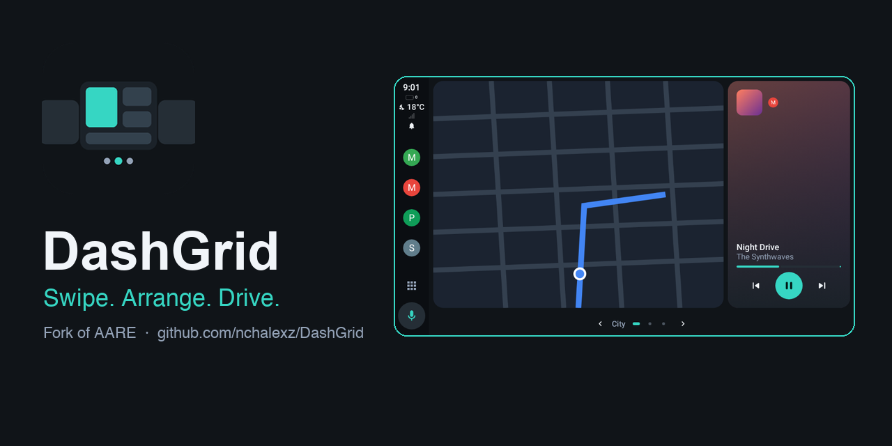
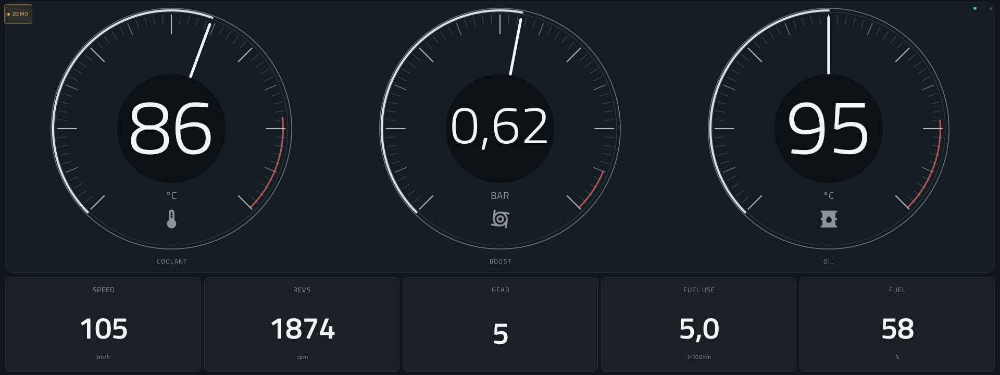
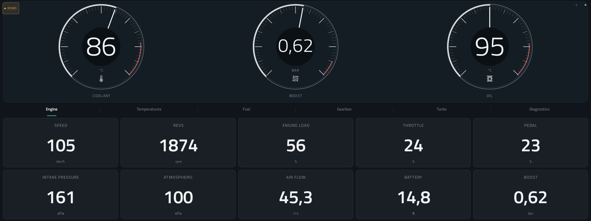
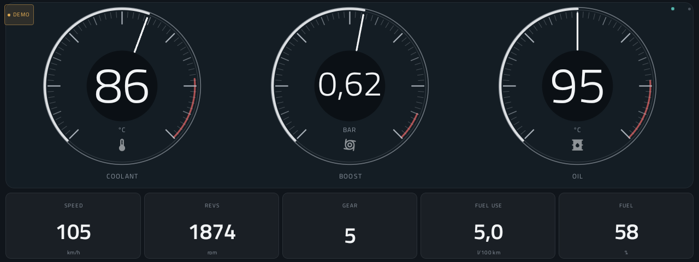
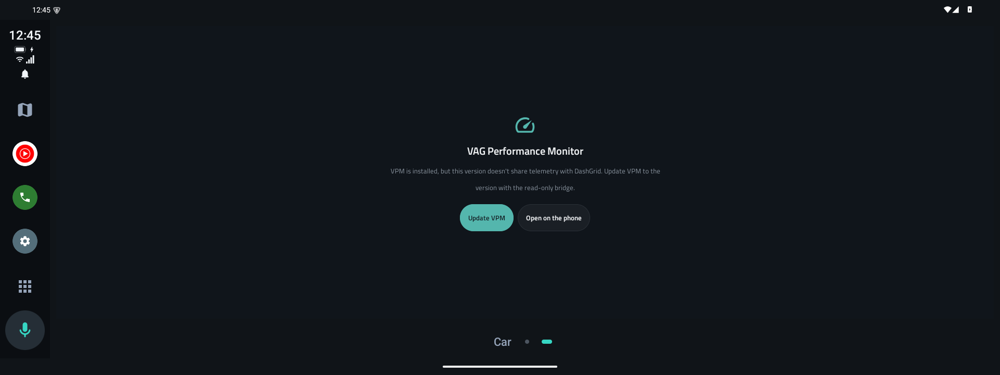

<p align="center">
  
</p>

<h1 align="center">DashGrid 1.2.0</h1>

<p align="center">
  <strong>TEST RELEASE — the VPM cockpit, drawn by DashGrid.</strong><br>
  27 November 2026
</p>

> [!WARNING]
> **This is a test release, not a stable one.** It is published as a GitHub pre-release so it can be
> installed and checked, not as a daily driver. The VPM cockpit cannot show live values until VPM
> ships its read-only bridge, nothing here is verified on a real head unit, and compatibility is
> still open (see [Limits](#limits)).

DashGrid 1.2.0 adds the first native cockpit: a preinstalled **Car** workspace with **VAG
Performance Monitor**'s three gauges, five tiles and category grid, drawn by DashGrid itself. VPM
stays the only owner of the ELM327 adapter; DashGrid opens no OBD connection and needs no root or
Shizuku.

In this release: [Cockpit](#cockpit) · [Car workspace](#car-workspace) · [Data](#data-from-vpm) ·
[Install](#install) · [Verification](#verification) · [Limits](#limits)

> [!IMPORTANT]
> **Live values need a VPM with the read-only bridge.** VPM 0.4.1 exports no telemetry snapshot, so
> today the Car workspace shows a calm “VPM is installed, but this version doesn't share telemetry”
> card with **Update VPM** and **Open on the phone** instead of gauges. The exact VPM-side task is in
> [docs/VPM_BRIDGE_PROMPT.md](https://github.com/nchalexz/DashGrid/blob/main/docs/VPM_BRIDGE_PROMPT.md);
> when VPM ships it, this DashGrid build reads it without an update.

## Cockpit

<p align="center">
  
</p>
<p align="center"><sub>1920 × 720: coolant, boost and oil over speed, revs, gear, fuel use and fuel.
A render of the running app on an emulator with VPM's own mock values — not a head-unit capture.</sub></p>

<p align="center">
  
</p>
<p align="center"><sub>The extended screen: the same gauges smaller, the six category tabs and the
adaptive grid. A gauge tap opens the tab of its category.</sub></p>

The composition is VPM 0.4.1's, not an approximation:

- three gauges with VPM's geometry — 0.44R disc, 0.78R value, 0.54R unit, 0.73R pictogram, 1.15R
  name, 60 ticks, 135°/270° scale, the bright arc and the red zone;
- five tiles, two-row category grid, Engine / Temperatures / Fuel / Gearbox / Turbo / Diagnostics;
- VPM's night and day tokens, Titillium Web and its comma number style;
- the **DEMO** pill stays, so VPM's demo values are never mistaken for a car;
- VPM's own service row (catalog, settings, close) is not duplicated: the rail and dock are
  DashGrid's, and the gauges get the height that row would take.

<p align="center">
  
</p>
<p align="center"><sub>1280 × 480: the gauges shrink, the five tiles stay on one row.</sub></p>

## Car workspace

- A workspace with the fixed id `workspace-car`, named **Car** (`Автомобиль`), added once to a
  configuration written before version 2.
- A deleted Car workspace does not come back; existing names, items, the default and the last-shown
  workspace are not touched.
- One built-in widget (`vpm`) fills the 10 × 6 grid. The editor can add the same cockpit elsewhere;
  the existing OBD `car` widget and the OBD app are unchanged and remain a separate product.
- The widget is a new kind of built-in card, not an app shortcut and not a live pane: it needs no
  Shizuku and no root.

<p align="center">
  
</p>
<p align="center"><sub>What VPM 0.4.1 shows today: the workspace is there, the card explains the
missing bridge and offers the two next steps.</sub></p>

## Data from VPM

DashGrid reads one read-only ContentProvider call, nothing else:

| Item | Value |
|---|---|
| Authority | `io.github.nchalexz.aaperfmon.telemetry` |
| Permission | `io.github.nchalexz.aaperfmon.permission.READ_TELEMETRY` (`normal`) |
| Call | `call("snapshot", null, null)` |
| Contract version | `1` |

The snapshot carries the link state, VPM's status line, `updatedAt` and up to 128 signals: id, label,
formatted value, unit, numeric display value, stale flag, warning flag and category. The array is
grouped by VPM's display category and keeps VPM's order; a signal VPM shows under two tabs appears
once per tab. Only the visible page polls (500 ms), and a bridge problem is logged once, not five
times a second.

VPM stays the only owner of the adapter. DashGrid polls no PID, starts no service and opens no
second ELM327 connection. The Cockpit's built-in OBD stack is untouched.

## Install

Download
[DashGrid-standalone-v1.2.0.apk](https://github.com/nchalexz/DashGrid/releases/download/dashgrid-v1.2.0/DashGrid-standalone-v1.2.0.apk),
then install it with `adb install -r` or by opening the file.

```text
19,707,760 bytes
SHA-256  ee4e228afa6a94d2d4fbee1122237c8f359e221e0bdaed8208dfd4d34c939546  DashGrid-standalone-v1.2.0.apk
certificate SHA-256: 4c464d2c35c723c2bc4ca30dafa84c3dbdf16473d61ec9961e37dc6e973420a5
```

> [!IMPORTANT]
> This release is **standalone only**. The APK defines `android.car.permission.TEMPLATE_RENDERER`
> itself, so **AARE must be uninstalled first**. That also removes AARE's settings. DashGrid updates
> use the same key and install over the old build.

Requirements: Android 6.0 or newer, USB or wireless Android Auto, no Google Mobile Services.
**No new runtime permission is requested.** The cockpit declares VPM's normal read-only permission;
until VPM defines it, the declaration is inert.

## Verification

- 1,191 JVM tests (947 app, 219 `aap`, 25 `headunit`), 0 failures.
- `assembleDebug`, `assembleStandalone` and `lintVital` pass.
- The Car workspace and the cockpit were run on an Android 15 emulator at 1920 × 720 and
  1280 × 480: fresh install → Home + Car, the 100 % cockpit page, the no-bridge card, both cockpit
  screens, the swipe, a tab tap and a gauge tap opening its category.
- The cockpit was drawn with VPM's own mock values by a debug-only preview activity; the release APK
  does not contain it.
- No OBD/ELM327 attempt appears in the log while the cockpit is open.
- Not verified: a real VPM with the bridge, a real ELM327 or car, a real head unit, EMUI 14+.

## Limits

- **Live values wait for VPM.** VPM 0.4.1 has no bridge; the cockpit shows the update card until a
  VPM release adds the read-only provider. DashGrid then needs no update.
- **No hardware verification.** 1.2.0 has not been run on a head unit, a phone in a car or EMUI; the
  emulator captures are not compatibility proof.
- **Head-unit quirks remain AARE's.** `vehicles.json` still handles cars that need a different
  protocol.
- **One live map surface and one Android widget view per bound id**, as before.

## Documentation

- [VPM cockpit](https://github.com/nchalexz/DashGrid/blob/main/docs/VPM.md) — screens, contract,
  states, checks and files.
- [VPM bridge task](https://github.com/nchalexz/DashGrid/blob/main/docs/VPM_BRIDGE_PROMPT.md) — the
  provider VPM must add.
- [README](https://github.com/nchalexz/DashGrid/blob/main/README.md) · [CHANGELOG](https://github.com/nchalexz/DashGrid/blob/main/CHANGELOG.md) ·
  [TESTING](https://github.com/nchalexz/DashGrid/blob/main/TESTING.md).
