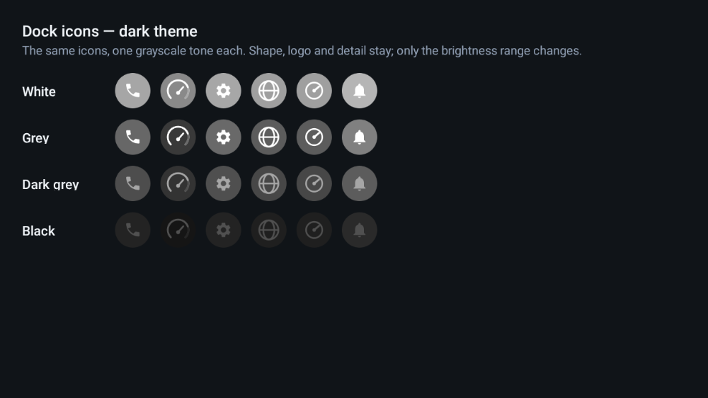
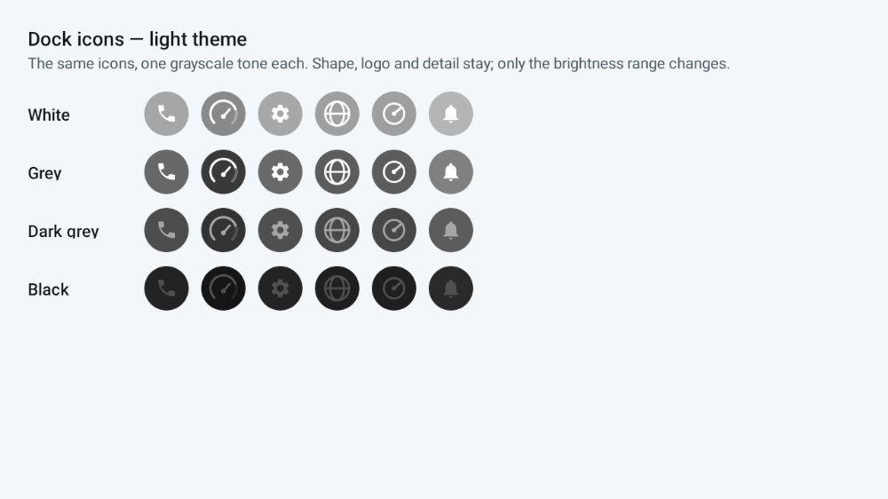
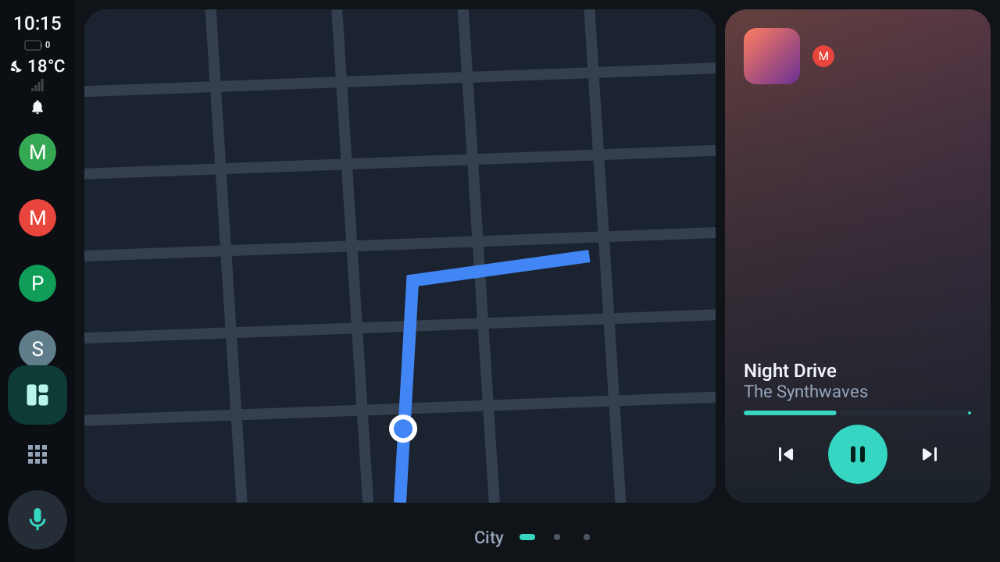

<p align="center">
  
</p>

<h1 align="center">DashGrid 1.1.0</h1>

<p align="center">
  <strong>Swipe. Arrange. Drive.</strong><br>
  26 November 2026
</p>

DashGrid 1.1.0 puts your own **Android app widgets** on the workspace grid, gives the dock a
**monochrome mode with four tones**, pins **Home** and **App Dash** where the driver expects them,
and adds **the Cockpit** — a dashboard for the car itself.

In this release: [Android app widgets](#android-app-widgets) · [Dock](#dock) ·
[Cockpit](#the-cockpit) · [Install](#install) · [Verification](#verification)

> [!IMPORTANT]
> This release is **standalone only**. The APK defines `android.car.permission.TEMPLATE_RENDERER`
> itself, so **AARE must be uninstalled first**. Removing AARE also removes its settings.

<p align="center">
  <a href="https://github.com/nchalexz/DashGrid/releases/download/dashgrid-v1.1.0/DashGrid-standalone-v1.1.0.apk"></a>
</p>

## Android app widgets

A standard Android app widget can now live in a workspace's cells: a clock, a weather card, a fuel
log, an OBD dashboard from another app. It is the provider's own live view — updating, scrolling and
taking taps — not a screenshot.

- Add one in **Settings → Workspaces → edit a workspace → Android widget**.
- The picker lists every provider installed on the phone, with its app icon, widget name, minimum
  size and preview. Nothing is filtered by a fixed catalogue.
- The first widget from a provider asks for Android's own permission on the phone
  (`ACTION_APPWIDGET_BIND`); the provider's configuration screen (`ACTION_APPWIDGET_CONFIGURE`)
  opens there too. **No Shizuku and no root.**
- The view is inflated with the car screen's density, and the cells' size in dp is reported back to
  the provider, so a resizable widget reflows instead of being stretched. No tint, no scaling, no
  dock filter: the provider keeps its own design.
- Ids survive restarts and reconnects, and the host listens only during a car session. Removing the
  item or its workspace releases the id; a removed provider shows a placeholder; several widgets and
  several instances of one provider work; a duplicated workspace does not share a bound widget.
- A workspace with a live widget keeps its normal pager gestures even with “swipe anywhere” on:
  swiping inside the widget does not change pages, so the widget's own horizontal gestures work.
- **Move to another workspace** moves the item without allocating a new widget: the same bound
  instance follows it.
- Widgets built with **Glance** are hosted as ordinary RemoteViews, like any other provider.

The architecture, the instructions and the limits are in
[docs/ANDROID_WIDGETS.md](https://github.com/nchalexz/DashGrid/blob/main/docs/ANDROID_WIDGETS.md).

## Dock

### Monochrome icons

Off by default. The dock's icons are drawn as grayscale by their own brightness, keeping each icon's
shape, logo, detail, transparency and the active-app highlight. The app grid and the workspaces keep
their colours.

Choose a tone for the light theme and one for the dark theme: **White**, **Grey**, **Dark grey** or
**Black**. Defaults are Dark grey in light colours and White in dark ones. The day/night switch
applies the matching tone without a restart, and processed icons are cached. The settings show a
preview of the phone's real icons in every tone.

| Four tones, dark theme | Four tones, light theme |
|:--:|:--:|
|  |  |
| **Monochrome dock** | **Home and App Dash, pinned** |
|  |  |

The renders use DashGrid's own app artwork; icons from third-party apps can differ on a real screen.

### Fixed navigation

**Always show the Home button** and **Always show the App Dash button** are independent and off by
default. When switched on, each sits at a fixed place at the driver's end of the rail, dock or
app-grid bar — outside the scrolling recent-app row — on every workspace, in the app grid and inside
apps, so recent apps cannot push them out.

The actions are unchanged: Home returns to the workspace you left, App Dash opens the app grid.
AARE's switching button is hidden only when it would repeat a fixed action. Both settings are
included in the settings backup.

## The Cockpit

The Cockpit is now a proper dashboard for the car:

- **Car profile** in the Cockpit's settings: *Generic* or **Golf 7 2.0 TDI (CUNA) · DQ381**, which
  fills in diesel, 1968 cm³, a 50 L tank, 1500 kg with the driver, and a 5000 rpm rev counter with
  its red line at 4600. Every value stays editable afterwards.
- **Values page** with coolant, boost or load, and oil or intake air dials, plus tiles for speed,
  revs, gear, throttle, pedal, intake and atmospheric pressure, rail pressure, EGT 1 and 2, air
  flow, fuel rate and level, battery and consumption.
- **Exhaust gas temperature and rail pressure** from the standard PIDs (`0x78`, `0x79`, `0x23`),
  read by the same poller. A car that does not report them gets no tile.
- **VAG identifier probe** (read-only, UDS service `22`) walks the engine's and gearbox's identifier
  ranges for the values a particular software version uses, and writes the answers to the
  connection log.
- **Compact Cockpit card** in a live app pane: under 800 dp wide or 420 dp tall it shows three
  dials and five main tiles instead of the full tabbed page. The five card tiles are chosen in the
  Cockpit's settings (*Card tiles*).
- **A quieter look**: flat tiles with a hairline outline, white numbers on a dark theme, the
  cluster-style Titillium Web typeface, dial pictograms, and a hybrid dial that takes the Porsche
  cluster's hairline rim and the VW power display's thick needle.

The old Track, Lap and Dyno pages are gone; the first tab is the same card the app pane shows, so
the glanceable screen and the full window cannot drift apart.

## Install

Download
[DashGrid-standalone-v1.1.0.apk](https://github.com/nchalexz/DashGrid/releases/download/dashgrid-v1.1.0/DashGrid-standalone-v1.1.0.apk),
then:

```sh
adb uninstall net.prototux.aare   # only if AARE is installed
adb install -r DashGrid-standalone-v1.1.0.apk
```

| | |
|:--|:--|
| **Package** | `io.dashgrid.app` |
| **Version** | 1.1.0 (version code 10100) |
| **Minimum Android** | 6.0 (API 23) |
| **Size** | 19 MB |
| **SHA-256** | `f8ac4d91fe220fb0c2f01ac9cb810f5264086d2995e49c396636025c2310778a` |
| **Signing key** | `CN=DashGrid` |
| **Certificate SHA-256** | `4c464d2c35c723c2bc4ca30dafa84c3dbdf16473d61ec9961e37dc6e973420a5` |

```sh
shasum -a 256 DashGrid-standalone-v1.1.0.apk
# f8ac4d91fe220fb0c2f01ac9cb810f5264086d2995e49c396636025c2310778a
```

**Upgrading from DashGrid 1.0.x:** install over the old version; the package name, application ID
and signing key are unchanged.

**Coming from AARE:** uninstall AARE first. Its settings are removed with it and do not carry over.
The side-by-side variant is not attached to this release; it can still be built locally with
`./gradlew dashgridApk`.

## Verification

- **1,162 unit tests pass**: `app` 918, `aap` 219, `headunit` 25. The release build compiles and
  passes `lintVital`; CI runs the tests on every push.
- **No car, phone or emulator was available for this build.** The widget host, the dock tones on a
  real head unit, third-party icons and EMUI 14+ are implemented and compile, but are **not
  verified on a device**. The exact checklist and the open points are in
  [TESTING.md](https://github.com/nchalexz/DashGrid/blob/main/TESTING.md). Please do not treat this
  release as confirmed compatible with EMUI or any particular head unit.
- If you can test it in a real car, please open an issue with the phone and head unit models and
  what worked. That report is more useful than a +1.

## Known limitations

- One live map surface per connection; inactive workspaces show a placeholder.
- One live view per bound Android widget id; the phone preview shows a placeholder while a real car
  session is connected.
- A widget button whose action is an activity `PendingIntent` may open on the phone or be refused by
  Android's background-activity rules; broadcast and service actions are unaffected.
- Third-party dock icons are processed from their own artwork, so tones can read differently from
  app to app.
- The published build does not check for updates itself; new releases are installed by hand.

## Documentation

- [README](https://github.com/nchalexz/DashGrid#readme)
- [Architecture](https://github.com/nchalexz/DashGrid/blob/main/ARCHITECTURE.md)
- [Android app widgets](https://github.com/nchalexz/DashGrid/blob/main/docs/ANDROID_WIDGETS.md)
- [Test report](https://github.com/nchalexz/DashGrid/blob/main/TESTING.md)
- [Full changelog](https://github.com/nchalexz/DashGrid/blob/main/CHANGELOG.md)
- [All changes since 1.0.7](https://github.com/nchalexz/DashGrid/compare/dashgrid-v1.0.7...dashgrid-v1.1.0)

## Thank you

DashGrid is a fork of [AARE](https://github.com/prototux/AARE), and this release is mostly built on
AARE's connection, transport and audio work. Thanks to prototux and the AARE contributors, and to
everyone who reports what happens on a real car.

AARE is GPL-3.0-or-later; DashGrid keeps that licence. This is a fork, not an official AARE
release.
