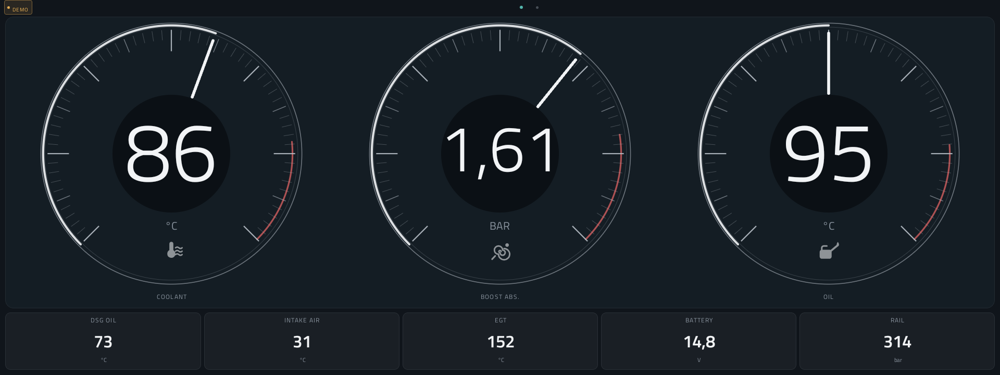
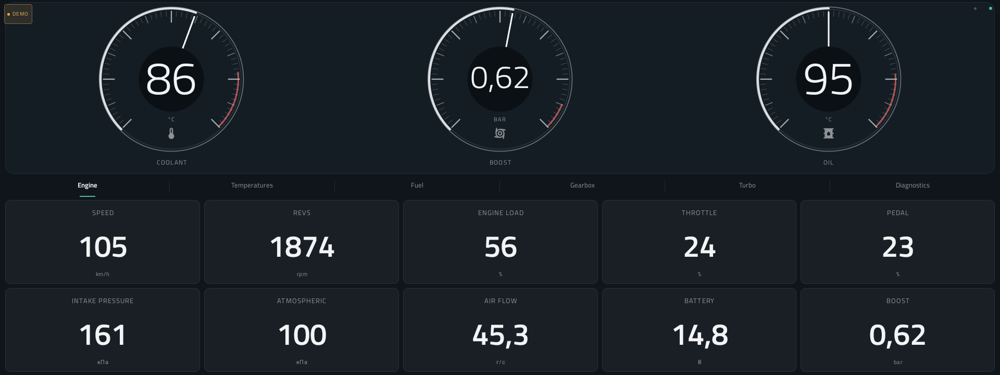
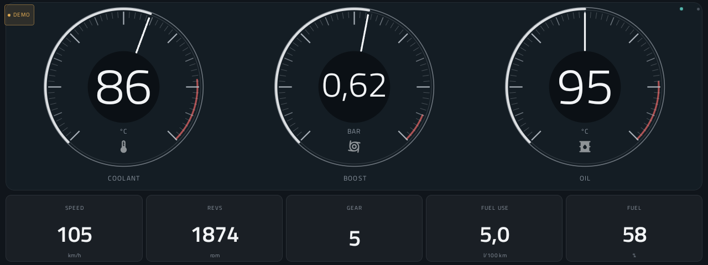
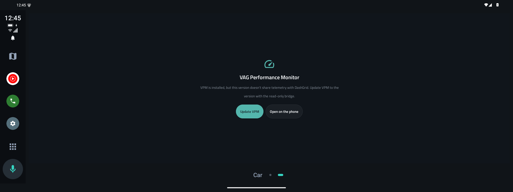

# VAG Performance Monitor cockpit

DashGrid can preinstall a **Car** workspace that shows **VAG Performance Monitor** (VPM,
`io.github.nchalexz.aaperfmon`) as a native cockpit: DashGrid draws the three gauges, the five tiles
and the category grid itself, and reads the values VPM already holds. VPM remains the only owner of
the ELM327 adapter and the VAG UDS session; DashGrid opens no OBD connection and subscribes to no
PID.

This is not a copy of VPM's window and not a second app session. It is DashGrid's own Kotlin/Compose
module with VPM 0.4.1's composition (`Gauge.kt`, `DashboardScreens.kt`, `MetricRegistry.kt`).

## What the workspace contains

- A workspace with the fixed id `workspace-car`, named **Car** (`Автомобиль` in Russian), added once
  to a configuration written before version 2. Its version marker is why deleting the workspace does
  not bring it back. Existing names, items, the default and the last-shown workspace are untouched.
- One built-in widget, id `vpm`, across the whole 10 × 6 grid. The editor can add the same widget to
  another workspace; the built-in `car` (OBD) widget is a separate widget and is unchanged.
- No app shortcut, no Shizuku, no root: the cockpit reads a normal read-only ContentProvider, so the
  one pane that used to need a privileged launcher now needs none.

## The screens

<p align="center">
  
</p>
<p align="center"><sub>The main screen at 1920 × 720, drawn by DashGrid on an emulator from VPM's own
mock values. It is a render of the running app, not a head-unit capture, and not proof of
compatibility.</sub></p>

<p align="center">
  
</p>
<p align="center"><sub>The category screen at 1920 × 720. Tapping a gauge opens the tab of its
category; the tabs and the grid are VPM's Engine / Temperatures / Fuel / Gearbox / Turbo /
Diagnostics.</sub></p>

<p align="center">
  
</p>
<p align="center"><sub>The same composition at 1280 × 480: the gauges shrink, the five tiles stay on
one row.</sub></p>

<p align="center">
  
</p>
<p align="center"><sub>What a phone with VPM 0.4.1 shows: the workspace is there, the card explains
that this VPM has no bridge, and offers **Update VPM** and **Open on the phone**. The rail, dock and
workspace bar are DashGrid's; the card fills the page.</sub></p>

The one deviation from VPM's screenshot that is deliberate: VPM's own service row (catalog,
settings, close) is not duplicated, so the gauges get the height that row would take. The **DEMO**
pill stays, so demo values are never mistaken for a car.

## Geometry and tokens

The gauge follows VPM 0.4.1's geometry (its `Gauge.kt`):

| Element | Position / size |
|---|---|
| Centre and value | X = 0, Y = 0 |
| Outer radius | R |
| Dark disc | 0.44R |
| Maximum value width | 0.78R |
| Unit centre | X = 0, Y = 0.54R |
| Pictogram centre | X = 0, Y = 0.73R |
| Pictogram size | 0.18R |
| Gauge name | X = 0, Y = 1.15R |

The value is centred on the glyphs' real bounds, not on the baseline, and shrinks until the number,
its comma and its minus fit the disc. The ring pair, the bright progress arc between them, the red
zone, the 60 ticks and the needle are drawn from the same constants as VPM: 135° start, 270° sweep.
The main screen is three gauges (`coolant 40…120 °C`, `boost −1…2 bar`, `oil 40…150 °C`) and five
tiles (speed, revs, gear, fuel use, fuel); the category screen is the same gauges smaller, the six
tabs and a grid of two full rows, 2–5 columns by width.

Text uses Titillium Web, which DashGrid already ships. Colours are VPM's night and day tokens
(`#10151B…#E8ECEF` and the rest); the car screen's Material palette is not used inside the cockpit.
Night and day follow the current car theme.

## The data contract

VPM answers a read-only `ContentProvider` call; DashGrid never starts VPM's service and never polls
the adapter from the provider.

| Item | Value |
|---|---|
| Authority | `io.github.nchalexz.aaperfmon.telemetry` |
| Permission | `io.github.nchalexz.aaperfmon.permission.READ_TELEMETRY` (`normal`) |
| Method | `call("snapshot", null, null)` |
| Other methods | not supported; `query`/`insert`/`update`/`delete` are not allowed |
| Contract version | `1` |

The bundle carries `version` (Int), `connection` (`demo`, `connecting`, `connected`, `disconnected`,
`error`), `status` (VPM's own line), `source` (transport, optional), `updatedAt` (when VPM last
changed values, not when DashGrid read it) and `signals` (JSON array, 128 entries at most).

Every signal is what VPM's own cockpit shows:

```json
{
  "id": "engine.coolant_c",
  "label": "ОЖ",
  "value": "86",
  "unit": "°C",
  "raw": 86,
  "stale": false,
  "warning": false,
  "category": "temperatures"
}
```

`value` is formatted text (comma decimals), `raw` is the same number in display units (bar for
boost, not kPa), `stale` and `warning` are VPM's own flags. The array is grouped by category in
VPM's display order; a signal VPM shows under two tabs (boost under Engine and Turbo) appears once
per tab with the matching `category`. DashGrid keeps the order, so each tab has the tiles of its
mockup.

Only the visible page polls: one Binder call every 500 ms while the Car workspace is on screen, and
nothing when it is not. A bridge problem is logged once, not five times a second.

## States the cockpit can be in

| Situation | What the user sees |
|---|---|
| VPM not installed | **VAG Performance Monitor is not installed** and **Install** (the releases page) |
| VPM installed, no bridge (VPM 0.4.1 today) | **VPM is installed, but this version doesn't share telemetry with DashGrid** and **Update VPM** / **Open on the phone** |
| Bridge present, VPM has not run yet | the cockpit with dashes and a **NO LINK** pill, never a drawn zero |
| VPM in demo | VPM's demo values with the **DEMO** pill |
| Live link | values, the **LIVE** pill and VPM's status line |
| Stale value | a dash and a stale dot, the needle fades out |
| Bridge refused | a card with **Open on the phone** / **Update VPM**, no crash |
| The page is off screen | a calm "VPM cockpit — on another page" tile, no polling |

The states are a pure mapping (`vpmUiState`) and are unit-tested, including the missing-app case.

## Requirements

- VPM installed on the same phone.
- A VPM release that exports the provider above. VPM 0.4.1 does not: this is the one VPM-side change
  that is still needed, and it is described in [VPM_BRIDGE_PROMPT.md](VPM_BRIDGE_PROMPT.md).
- If DashGrid was installed before VPM defined this permission, update DashGrid once after installing
  VPM's bridge (reinstall the same build): Android grants a normal permission when the app that
  requests it is installed or updated, not retroactively when another app defines it.
- Android 6 or newer, like the rest of DashGrid. No root and no Shizuku for this widget.

## What was checked

On a `sdk_gphone64_arm64` Android 15 emulator at 1920 × 720 and 1280 × 480, with VPM 0.4.1
installed and no bridge:

- A fresh install has **Home** and **Car**; the Car workspace is 100 % and contains one `vpm` item.
- The Car workspace draws the "VPM is installed, but this version doesn't share telemetry" card with
  **Update VPM** and **Open on the phone**; nothing crashes.
- The cockpit itself was run with VPM's mock values through a debug-only preview activity: both
  screens at 1920 × 720 and 1280 × 480, the swipe between them, a tab tap, a gauge tap opening its
  category, and the DEMO pill.
- The unit tests cover the parser (bad JSON, missing fields, version mismatch, one entry per
  category), the readings (demo, live, disconnected, waiting, stale, warning/critical, the VAG oil
  alternative), the preset (added once, deleted stays deleted, JSON round-trip) and the state cards.
- No OBD/ELM327 connection was opened by DashGrid: the cockpit has no OBD code, and the log shows a
  single bridge "no provider" line, not an adapter attempt.

Not checked: a real VPM with the bridge (VPM 0.4.1 has none), a real ELM327 or car, a real head unit,
the 1280 × 480 layout on hardware, and driving rules with a real vehicle-speed signal. Test renders
and emulator captures are not proof of head-unit compatibility.

## Trying it without a car

The debug build has a preview activity with VPM's mock values (not part of a release APK):

```sh
adb install -r app/build/outputs/apk/debug/app-debug.apk
adb shell am start -n io.dashgrid.app/net.prototux.aare.vpm.VpmPreviewActivity --ei page 1
# page 0 = main, page 1 = categories; --ez night false for the day palette
```

The real car screen on the phone is the ordinary **Settings → Workspaces → Preview car screen**.

## The cross-repository release session

When VPM's bridge is ready, the session that verifies both apps, runs both test suites, checks
compatibility and publishes VPM and DashGrid releases follows
[VPM_COMPAT_PROMPT.md](VPM_COMPAT_PROMPT.md). This page remains the DashGrid-side description.

## Files

- [`VpmSnapshot.kt`](../app/src/main/java/net/prototux/aare/vpm/VpmSnapshot.kt) — the contract, the
  parser and the connection kinds.
- [`VpmBridge.kt`](../app/src/main/java/net/prototux/aare/vpm/VpmBridge.kt) — the provider call, the
  package lookups and the install/releases actions.
- [`VpmMetrics.kt`](../app/src/main/java/net/prototux/aare/vpm/VpmMetrics.kt) — the main-screen
  metrics, the readings and the category mapping.
- [`VpmGauge.kt`](../app/src/main/java/net/prototux/aare/ui/car/vpm/VpmGauge.kt) — the gauge and its
  geometry.
- [`VpmScreens.kt`](../app/src/main/java/net/prototux/aare/ui/car/vpm/VpmScreens.kt) — the two
  screens, the tiles, the tabs and the pill.
- [`VpmCockpit.kt`](../app/src/main/java/net/prototux/aare/ui/car/vpm/VpmCockpit.kt) — polling, the
  cards and the pager.
- [`WorkspaceModel.kt`](../app/src/main/java/net/prototux/aare/workspace/WorkspaceModel.kt) — the
  preset, the ids and the config version.
